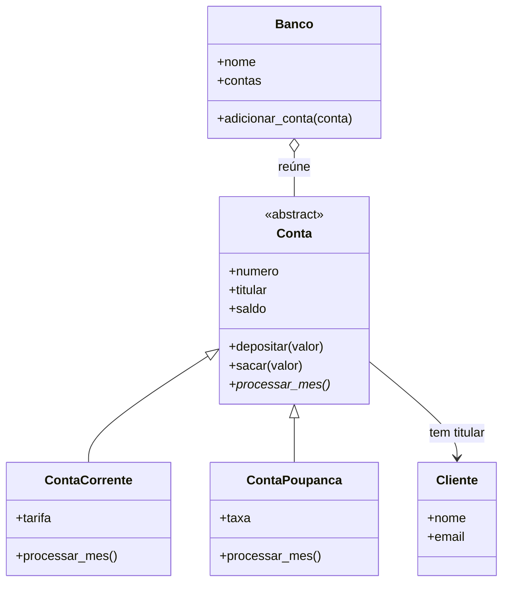

# Meu sistema bancário — Desafio Sprint 6

## Apresentação

Neste projeto, desenvolvi um sistema bancário didático em Python para aplicar os conceitos de Programação Orientada a Objetos. Escolhi esse tema porque consigo representar clientes e contas, definir regras para movimentações e demonstrar comportamentos diferentes para conta corrente e conta poupança.

Meu sistema funciona no terminal e utiliza somente a biblioteca padrão do Python. Os dados ficam na memória durante a execução. Usei clientes fictícios e não implementei integração com bancos reais.

## Como organizei meu projeto

- `modelos.py`: defini minhas classes e as regras de validação.
- `main.py`: preparei a demonstração com dez contas e exemplos de erros tratados.
- `testes.py`: organizei nove testes automatizados para verificar as regras.
- `exemplo_saida.txt`: incluí a saída da demonstração.
- `README.md`: documentei minhas decisões e as instruções de execução.

## Minha modelagem de classes

Modelei cinco classes principais: `Cliente`, `Conta`, `ContaCorrente`, `ContaPoupanca` e `Banco`. Também criei a exceção `SaldoInsuficienteError`.



## Minhas decisões de implementação

### Classe abstrata e herança

Defini `Conta` como uma classe abstrata usando `ABC` e `@abstractmethod`. Dessa forma, não permito a criação direta de uma conta genérica e exijo que minhas classes filhas implementem `processar_mes()`.

Usei herança porque conta corrente e conta poupança **são contas**. Reaproveitei as operações de depósito e saque e chamei `super().__init__()` nos construtores das duas classes filhas.

### Relações entre objetos

Associei um objeto `Cliente` a cada conta porque uma conta **tem um titular**; ela não é um cliente. O banco reúne os objetos de conta por agregação. Essas associações permitem que eu use objetos dentro de outros objetos sem criar uma herança inadequada. Como um cliente ou uma conta podem existir independentemente do banco, não caracterizei essas relações como composição estrita de ciclo de vida.

### Encapsulamento e validações

Utilizei atributos com prefixo `_` e propriedades com `@property`. Nas propriedades que podem ser alteradas, implementei setters que validam o valor antes de atualizar o atributo. Sei que o prefixo `_` é uma convenção de uso interno em Python, e não um bloqueio absoluto de acesso.

Validei nome e número não vazios, formato de e-mail, tipo do titular, saldo e tarifa não negativos e taxa entre 0 e 1. Mantive o número da conta somente para leitura para evitar mudanças na identificação de uma conta já cadastrada. Para proteger a coleção do banco, exponho suas contas como uma tupla.

Usei `Decimal` para representar os valores monetários. Aceito no máximo duas casas decimais, rejeito valores não finitos e exijo valores positivos nas movimentações. Para rendimentos, arredondo para centavos com a regra padrão do `Decimal` (empate para o par). Minha regex de e-mail valida um formato simplificado, sem confirmar a existência do endereço.

### Polimorfismo

Implementei `processar_mes()` nas duas classes filhas. Na conta corrente, desconto uma tarifa mensal; na poupança, acrescento um rendimento. Percorro uma coleção com as duas modalidades e faço a mesma chamada para todas as contas, obtendo resultados diferentes conforme a classe do objeto.

Limitei o desconto da tarifa ao saldo disponível. Assim, preservo a regra de saldo não negativo: se uma conta tiver R$ 5,00 e a tarifa for R$ 10,00, desconto apenas R$ 5,00. Essa é uma regra do meu exemplo acadêmico.

### Construtores e métodos especiais

Implementei `__init__()` e `__str__()` em todas as cinco classes principais. Nas classes filhas, aproveitei a representação da classe mãe com `super().__str__()`.

Também utilizei `__repr__()` para facilitar a inspeção dos objetos e `__len__()` em `Banco` para consultar a quantidade de contas. As classes filhas herdam a representação de depuração de `Conta`.

### Tratamento de exceções

Criei `SaldoInsuficienteError` para representar saques acima do saldo e utilizei `ValueError` para valores que não respeitam minhas regras. No programa principal, tratei essas situações com `try/except`, exibindo uma mensagem e permitindo que a demonstração continue.

## Minha demonstração e meus testes

Na demonstração, criei dez clientes e dez contas, sendo cinco contas correntes e cinco poupanças. Para cada conta, apliquei a regra mensal e mostrei os resultados no terminal.

Com saldo inicial de R$ 1.000,00:

- Minha conta corrente ficou com R$ 990,00 após a tarifa de R$ 10,00.
- Minha poupança ficou com R$ 1.005,00 após rendimento de 0,5%.

Também demonstrei depósito, saque, alteração inválida de e-mail, tentativa de saldo negativo e entradas inválidas. Após rejeitar esses valores, mantive os dados anteriores do objeto.

Nos nove testes, verifiquei a impossibilidade de instanciar a classe abstrata, movimentações, saldo insuficiente, valores inválidos, setters, polimorfismo, limite da tarifa, cadastro de dez contas, duplicidade de números e validação de taxas. Os testes passaram no ambiente de verificação do projeto.

## Como executo

Depois de extrair o ZIP, abro a pasta `atividade_3_poo` no VS Code e uso o terminal:

```bash
python main.py
```

Para executar meus testes:

```bash
python testes.py
```

No Windows, posso usar `py main.py` e `py testes.py` se o comando `python` não estiver disponível. Preciso de Python 3; não preciso instalar pacotes externos.

## Como preparo a entrega

Para atender ao enunciado, preciso enviar os arquivos a um repositório no GitHub e deixá-lo público ou liberar as permissões de visualização. Posso criar um repositório e usar **Add file > Upload files** para enviar os arquivos extraídos do ZIP. Depois, entrego o link do repositório.

O projeto foi preparado localmente; a publicação no GitHub ainda precisa ser feita.
